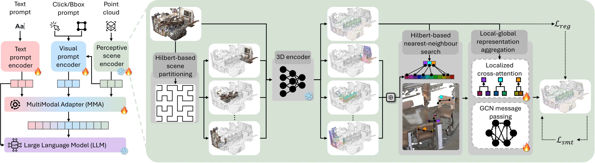

<div align="center">

# PerLA: Perceptive 3D Language Assistant

**CVPR 2025**

Guofeng Mei, Wei Lin, Luigi Riz, Yujiao Wu, Fabio Poiesi, Yiming Wang

[Paper](https://arxiv.org/abs/2411.19774) ·
[Project page](https://gfmei.github.io/PerLA/) ·
[Checkpoints](https://huggingface.co/RyanMei/PerLA)

</div>

PerLA is a 3D language assistant for question answering and dense captioning in
indoor scenes. Point-cloud language models usually see a heavily downsampled
scene and lose the fine detail that many questions depend on. PerLA processes
the scene in parallel local regions ordered along a Hilbert curve, then merges
local detail into the global scene representation with a learnable
superpoint-aware aggregation. A Q-Former turns the merged features into a
prefix for a frozen OPT-1.3B language model.

<p align="center">
  
</p>

## News

- **2026-11** · Code release with an improved training recipe, task-specific
  checkpoints, and a corrected PointNet++ ball query (see [Release notes](#release-notes)).
- **2025** · PerLA is accepted at CVPR 2025.

## Results

Task-specific training from the pretrained detector, without generalist
pretraining, on the ScanNet validation splits. Each number comes from a single
training run (seed 0); the checkpoint is the epoch with the best validation
CIDEr. LL3DA numbers are from its paper (Table 5, trained per task from
scratch).

### 3D question answering (ScanQA)

| Method | CIDEr | BLEU-4 | METEOR | ROUGE-L |
| --- | ---: | ---: | ---: | ---: |
| LL3DA | 74.80 | 13.68 | 15.40 | 36.25 |
| **PerLA** | **77.06** | **13.91** | **15.46** | **37.00** |

### 3D dense captioning (IoU 0.5)

| Method | ScanRefer C | B-4 | M | R | Nr3D C | B-4 | M | R |
| --- | ---: | ---: | ---: | ---: | ---: | ---: | ---: | ---: |
| LL3DA | **62.84** | **35.81** | **25.81** | **54.45** | 44.95 | 27.67 | **25.67** | **55.79** |
| **PerLA** | 62.16 | 34.37 | 25.51 | 53.66 | **46.76**† | **28.25**† | 25.53† | 55.47† |

C: CIDEr, B-4: BLEU-4, M: METEOR, R: ROUGE-L.
† Nr3D training is still running; these numbers come from the first 8 of its
16 epochs. They will be updated with the final checkpoint.

The ScanQA and ScanRefer models use gated fusion. The Nr3D model also uses the
part and context prompts and 3D rotary position encoding described below; these
have not yet been trained on the other two benchmarks. Results with generalist
pretraining and fine-tuning are in the paper.

## Installation

The code is tested with Python 3.10, PyTorch 2.2.0 (CUDA 12.1) and
Transformers 4.40.2 on NVIDIA A100 GPUs.

```bash
git clone https://github.com/gfmei/PerLA.git
cd PerLA
conda create -n perla python=3.10 -y
conda activate perla
pip install torch==2.2.0 --index-url https://download.pytorch.org/whl/cu121
pip install -r requirements.txt
```

METEOR evaluation needs Java 11 or newer on the `PATH`. Optionally, compile
the Cython box-intersection routine for faster evaluation:

```bash
cd libs && python cython_compile.py build_ext --inplace && cd ..
```

## Data preparation

**ScanNet scenes.** Download [ScanNet v2](https://github.com/ScanNet/ScanNet)
and export the scenes (vertices with color and normals, instance and semantic
labels, boxes, and superpoints):

```bash
cd datasets/scannet
python batch_load_scannet_data.py --scannet_dir /path/to/scannet/scans \
                                  --output_dir ../../data/scannet/scannet_data
cd ../..
```

Each scene produces `*_aligned_vert.npy`, `*_aligned_bbox.npy`,
`*_ins_label.npy`, `*_sem_label.npy` and `*_spt.npy`. The training and
evaluation scripts read them from `data/scannet/scannet_data`; set `DATA_ROOT`
to use another location.

**Annotations.** ScanRefer, Nr3D and 3D-LLM annotations are included under
`data/`. Download [ScanQA](https://github.com/ATR-DBI/ScanQA/blob/main/docs/dataset.md)
and place it as follows:

```text
data/
├── ScanQA/ScanQA_v1.0_{train,val}.json
├── ScanRefer/ScanRefer_filtered_{train,val}.json
├── Nr3D/nr3d_{train,val}.json
└── 3D_LLM/3d_llm_*_{train,val}.json
```

**Models.** The pretrained 3D detector
(`pretrained/scannet_vote2cap_detr_XYZ_COLOR_NORMAL.pth`) is included.
[OPT-1.3B](https://huggingface.co/facebook/opt-1.3b) and the
[Q-Former embeddings](https://huggingface.co/CH3COOK/bert-base-embedding) are
downloaded from the Hugging Face Hub on first use. To use local copies, set
`OPT` and `QFORMER` to their directories.

## Evaluation

Download a checkpoint and evaluate it on the validation split:

```bash
hf download RyanMei/PerLA perla_scanqa.pth --local-dir ckpts
bash scripts/eval.sh scanqa ckpts/perla_scanqa.pth
```

The first argument selects the benchmark: `scanqa`, `scanrefer` or `nr3d`.
Predictions and metrics are written next to the checkpoint (or to
`OUTPUT_DIR`). Use `NGPUS=4` to evaluate on several GPUs. Metrics are printed
as fractions; the tables above multiply them by 100.

| Checkpoint | Benchmark | Recipe |
| --- | --- | --- |
| [`perla_scanqa.pth`](https://huggingface.co/RyanMei/PerLA/blob/main/perla_scanqa.pth) | ScanQA | gated fusion |
| [`perla_scanrefer.pth`](https://huggingface.co/RyanMei/PerLA/blob/main/perla_scanrefer.pth) | ScanRefer | gated fusion |
| `perla_nr3d.pth` (coming soon) | Nr3D | gated fusion, part/context prompts, 3D RoPE |

## Training

Train on one benchmark with two GPUs (global batch 16):

```bash
bash scripts/train.sh scanqa    outputs/perla_scanqa
bash scripts/train.sh scanrefer outputs/perla_scanrefer
bash scripts/train.sh nr3d      outputs/perla_nr3d
```

Training uses a cosine learning-rate schedule over 24 epochs (ScanQA) or 16
epochs (dense captioning) and validates after every epoch. Each epoch's
predictions and metrics are kept under `<output>/evaluations/`.
`checkpoint_best.pth` holds the best epoch, and `summary.json` records the best
and final results. On two A100 GPUs, one epoch including validation takes
about 1.5 hours on ScanQA and 1.7 to 1.9 hours on Nr3D and ScanRefer.

Long runs can be split into stages that keep the full schedule, for example
to fit cluster time limits. Re-running with the same output directory resumes
from its last epoch:

```bash
STOP_EPOCH=8 bash scripts/train.sh nr3d outputs/perla_nr3d                # epochs 1-8
START_EPOCH=8 bash scripts/train.sh nr3d outputs/perla_nr3d               # epochs 9-16
```

Environment variables: `NGPUS` (default 2, must divide 16), `DATA_ROOT`, `OPT`,
`QFORMER`. Any extra arguments are passed to `main.py`. A quick smoke test runs
two training steps and validates on 16 samples:

```bash
bash scripts/train.sh scanqa outputs/smoke-test --preflight_steps 2
```

**Generalist pretraining.** The paper's recipe first pretrains one model on
the LL3DA task mixture (ScanQA, ScanRefer, Nr3D and 3D-LLM), then fine-tunes it
per task:

```bash
bash scripts/generalist/pretrain.sh outputs/perla_generalist
bash scripts/generalist/finetune.sh scanqa outputs/perla_generalist/checkpoint_best.pth outputs/perla_scanqa_ft
```

## Method options

The release recipes are defined in [scripts/recipes.sh](scripts/recipes.sh).

| Option | Effect |
| --- | --- |
| `--fusion_method gated` | Blend local detail into the global scene features with a learned per-channel gate, initialized close to the global features. `baseline` replaces them with the local update, as in the paper. |
| `--local_loss_weight 0.1 --global_loss_weight 0.01` | Weights of the superpoint consistency losses. |
| `--qformer_rope` | Interleaved 3D rotary position encoding in the Q-Former cross-attention. Visual prompt tokens attend to scene features by their 3D offset from the prompted object; the learned latent queries attend by content only. |
| `--box_part_tokens` | Eight additional prompt tokens per box, one per octant, pooled from the dense local features with their mean color. |
| `--context_objects 8` | One prompt token for each of the 8 nearest other detected objects, for relational descriptions. |
| `--box_prompt_ratio 1.0 --min_box_prompt_iou 0.5` | Dense captioning: prompt every training sample with its box, as evaluation does, and skip the caption loss when no detected proposal overlaps the box (IoU < 0.5). |

## Release notes

- **Corrected ball query.** `query_ball_point` compared unsquared distances
  with the squared radius, which shrank every PointNet++ neighborhood (a
  0.2 m radius acted as 0.04 m). With the fix, the frozen detector reproduces
  its published detection accuracy.
- **Improved recipe.** Gated local–global fusion with smaller auxiliary-loss
  weights, plus part and context prompts with 3D rotary position for dense
  captioning.
- **Faster training.** Point sampling and Hilbert encoding run batched on the
  GPU, which roughly halves the training step time and lowers peak memory by
  more than half.
- **Reproducible staged training.** `scripts/train.py` checks resume
  consistency, reseeds every epoch, writes checkpoints atomically, and keeps
  per-epoch validation results.

## Tests

```bash
python -m unittest discover -s tests
```

The suite runs on the CPU; one point-sampling test additionally needs a GPU.

## Citation

```bibtex
@inproceedings{mei2025PerLA,
  title     = {PerLA: Perceptive 3D Language Assistant},
  author    = {Guofeng Mei and Wei Lin and Luigi Riz and Yujiao Wu and Fabio Poiesi and Yiming Wang},
  booktitle = {Proceedings of the IEEE/CVF Conference on Computer Vision and Pattern Recognition (CVPR)},
  year      = {2025}
}
```

## Acknowledgments

PerLA builds on [LL3DA](https://github.com/Open3DA/LL3DA),
[Vote2Cap-DETR](https://github.com/ch3cook-fdu/Vote2Cap-DETR) and
[3DETR](https://github.com/facebookresearch/3detr). We thank their authors and
the creators of ScanNet, ScanQA, ScanRefer, ReferIt3D and 3D-LLM.

Questions and bug reports are welcome as
[GitHub issues](https://github.com/gfmei/PerLA/issues) or by email to
[gmei@fbk.eu](mailto:gmei@fbk.eu).

## License

The code is released under the [Apache 2.0 license](LICENSE). The project
website is licensed under
[CC BY-SA 4.0](https://creativecommons.org/licenses/by-sa/4.0/).
