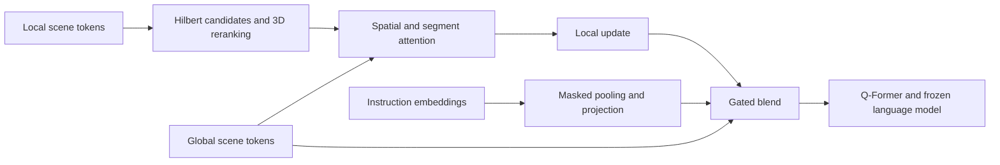

# Experimental instruction-conditioned fusion for PerLA

This is a method extension, with no measured ScanQA/ScanRefer accuracy gains
yet. The objective is to improve on the corrected PerLA baseline; LL3DA remains
an external reference. The implementation preserves the original frozen
detector and language-model backbones.

## Hypothesis

PerLA's merger selects neighbors using a scalar Hilbert key, masks different
segments when a same-segment neighbor exists, and sends its projected local
update to the Q-Former. The merge itself does not use the question. This can
discard useful global evidence, miss geometrically close points, and suppress
context across noisy superpoint boundaries.

The experimental variant addresses those three limitations:

1. **Geometric neighbor reranking.** Retrieve up to `4*K` source candidates by
   Hilbert key and choose `K` by Euclidean distance. Search remains approximate:
   the true Euclidean nearest point may lie outside the candidate set. It does
   not construct a dense global-to-local distance matrix.
2. **Learned spatial attention.** Subtract a positive learned distance penalty,
   normalized by the neighborhood's mean squared distance, and add a learned
   same-segment preference. Cross-segment context remains available instead of
   being hard-masked. This is enabled by `--neighbor_selection geometry`.
3. **Instruction-conditioned residual gate.** Pool the instruction's Q-Former
   word embeddings with its padding mask, project them to the scene dimension,
   and combine this context with normalized global and local features. A
   per-channel sigmoid gate chooses their blend:

   `output = global + sigmoid(W[global_norm, local_norm, instruction] + b) * (local - global)`

   The gate starts at `sigmoid(-2) ≈ 0.119`, retaining most global information
   while allowing local gradients immediately. Instruction weights start at
   zero and learn during training. This is enabled by `--fusion_method instruction`.
   Pooling is a lightweight bag-of-words summary, not an extra contextual
   language encoder. It reads instruction tokens, never target response tokens.



Serialized neighborhoods are an established efficiency tradeoff in
[Point Transformer V3](https://arxiv.org/abs/2312.10035), and gated multimodal
adaptation has precedent in [Flamingo](https://arxiv.org/abs/2204.14198).
Those results do not establish that this particular PerLA variant improves
accuracy. The reranking and instruction gate are hypotheses to test here.

## Ablations

| Variant | `--fusion_method` | `--neighbor_selection` | Purpose |
| --- | --- | --- | --- |
| Corrected PerLA | `baseline` | `hilbert` | Reference |
| Geometry only | `baseline` | `geometry` | Neighbor and attention changes |
| Gate only | `gated` | `hilbert` | Adaptive local/global blending |
| Instruction gate | `instruction` | `hilbert` | Added question conditioning |
| Full candidate | `instruction` | `geometry` | Combined method |

Defaults select the corrected baseline. At scene dimension 256 and Q-Former
dimension 768, the full candidate adds 395,266 parameters, including the
instruction projection. Dense captioning still merges once per
scene/instruction and reuses those features across proposal prompts.

For a controlled first comparison, initialize every variant from the **same**
generalist checkpoint. Keep the seed, train/validation splits, learning rate,
batch size, partition count, number of optimizer steps, auxiliary loss weights,
and decoding fixed. Use distinct output directories. If the full candidate
wins, repeat the comparison across three seeds and then test training its
generalist stage from the detector checkpoint. Do not attribute gains from a
simultaneous data or learning-rate change to the architecture.

Example ScanQA candidate run, using two already allocated GPUs:

```bash
SCANNET_ROOT=/path/to/prepared/scannet
GENERALIST=/path/to/generalist/checkpoint_best.pth

bash scripts/opt-1.3b/tuning.scanqa.sh \
  --root_dir "$SCANNET_ROOT" --pretrained_weights "$GENERALIST" \
  --ngpus 2 --batchsize_per_gpu 8 --n_splits 6 --n_neighs 24 --seed 0 \
  --fusion_method instruction --neighbor_selection geometry \
  --base_lr 1e-6 --final_lr 1e-6 \
  --local_loss_weight 1 --global_loss_weight 1 \
  --checkpoint_dir ckpts/method/scanqa-instruction-geometry-s0

bash scripts/opt-1.3b/eval.scanqa.sh \
  --root_dir "$SCANNET_ROOT" --ngpus 1 --batchsize_per_gpu 8 \
  --n_splits 6 --n_neighs 24 --seed 0 \
  --fusion_method instruction --neighbor_selection geometry \
  --test_ckpt ckpts/method/scanqa-instruction-geometry-s0/checkpoint_best.pth \
  --checkpoint_dir ckpts/method/scanqa-instruction-geometry-s0/eval
```

Repeat with the other matrix entries and matching output directories. Use the
ScanRefer tuning/evaluation scripts for CIDEr@0.5, preserving the same controls.
Evaluation and resume reject mismatched saved architecture settings or missing
trainable captioner weights; only warm-start training permits new gate weights.

## Implementation notes

Graph and Sinkhorn objectives are computed during training only. Evaluation
uses the same merged features without those auxiliary calculations. Graph
normalization uses row/column scaling to avoid dense products with diagonal
matrices.

Batched Hilbert key construction uses integer tensor operations on the input
device, avoiding Python point loops and GPU-to-CPU transfers while preserving
the scalar encoder's keys.

Surface normals follow the same geometric augmentation as the point
coordinates, and colors remain aligned through cuboid cropping. Use the same
preprocessing and augmentation settings for all ablation variants.

See the [benchmark protocol](ll3da_benchmark.md) for data requirements and
evaluation settings. Trained weights for this experimental variant are not
included.
